# DecisionLog

> **Keep the why behind every decision. Stop repeating old debates.**

Project teams frequently forget why technical or architectural decisions were made, leading to reopened arguments, lost momentum, and repeated debates. **DecisionLog** is a full-stack decision record management system built with the MERN stack and styled in a distinctive **1960s Pop-Art / Comic-Print** aesthetic.

Each decision record preserves:
- The **context** and background problem that forced the choice.
- All **options considered**, each evaluated with explicit pros and cons.
- The **chosen approach** with an in-depth rationale.
- An actionable **review date** that automatically flags decisions when they become stale or overdue.
- Bidirectional links to sprint **tasks**.
- A manual **Needs Reconsideration** flag with required justification.

---

## 1. Project Overview & The Problem It Solves

Software architecture and technical directions evolve rapidly. When teams don't write down why an option was selected over alternatives:
1. **New team members question settled choices** without understanding past constraints.
2. **Old debates are repeated** every sprint when difficulties arise.
3. **Outdated choices outlive their validity** because nobody remembered to revisit them.

DecisionLog solves this by providing a single, durable source of truth with automated review tracking and full integration into active development tasks.

---

## 2. Key Features

- **Architectural Decision Records (ADRs)**: Capture decision title, context, evaluated alternatives (pros & cons), chosen approach, rationale, author/team, decision date, and review date.
- **Automated Overdue Flagging**: Decisions past their scheduled review date are automatically tagged with a red calendar badge and highlighted across the dashboard and decision lists.
- **Manual Reconsideration Flags**: Reopen debates intentionally with a mandatory explanation (at least 5 characters), triggering visual alerts.
- **Bidirectional Task Linking**: Link active sprint tasks directly to decision records. Removing or deleting tasks or decisions automatically cleans cross-references.
- **Search, Filtering, Sorting & Pagination**: Case-insensitive substring and full-text search, status filters (Accepted, Proposed, Superseded, Deprecated), tag filters, overdue/flagged presets, sort options, and URL query persistence.
- **Responsive 1960s Pop-Art Design**: High-contrast sun-yellow canvas, bold near-black ink borders, hard zero-blur offset shadows, Ben-day halftone screens, and press-down interactive states across desktop, tablet, and mobile (including a mobile Filters bottom sheet).

---

## 3. Tech Stack

| Layer | Technologies |
| :--- | :--- |
| **Backend** | Node.js (18+), Express 4 (ES Modules), Mongoose 8 |
| **Validation & Security** | express-validator 7, helmet, cors, morgan, express-rate-limit, sanitize-html |
| **Frontend** | React 18, Vite 5, React Router 6, Axios, Lucide React |
| **Typography** | Archivo Black (Google Fonts, display), Inter (Google Fonts, UI/body) |
| **Database** | MongoDB 7 (local, Docker Compose, or Atlas) |
| **Dev Tools** | nodemon, concurrently |

---

## 4. Folder Structure

```text
decisionlog/
├── docker-compose.yml             # MongoDB 7 service on port 27017 with volume
├── package.json                   # Root scripts: dev, seed, install:all
├── README.md                      # Project documentation
├── docs/
│   ├── PROJECT_SPEC.md            # Complete backend & domain specification
│   ├── DESIGN_SYSTEM.md           # 1960s Pop-Art / Comic-Print design system
│   └── screenshots/               # High-resolution UI captures
│       ├── landing-1440.png
│       ├── landing-390.png
│       ├── dashboard-1440.png
│       ├── decisions-list-1440.png
│       ├── decisions-list-390.png
│       ├── decision-detail-1440.png
│       ├── decision-form-1440.png
│       └── tasks-1440.png
├── server/
│   ├── .env.example
│   ├── .env
│   ├── package.json
│   ├── scripts/
│   │   ├── smoke-test.js          # 18-point automated API test suite
│   │   └── mongo-runner.js        # In-memory Mongo runner for zero-install dev
│   └── src/
│       ├── server.js              # Server entry point & fatal error handlers
│       ├── app.js                 # Express app configuration & middleware
│       ├── config/db.js           # Mongoose connection management
│       ├── controllers/           # decisionController.js, taskController.js
│       ├── middleware/            # validate.js, errorHandler.js
│       ├── models/                # Decision.js, Task.js
│       ├── routes/                # decisionRoutes.js, taskRoutes.js
│       ├── utils/                 # AppError.js, dates.js, decisionFlags.js
│       └── seed.js                # Database seeder (7 decisions, 10 tasks)
└── client/
    ├── index.html                 # HTML shell with Google Fonts & inline SVG favicon
    ├── vite.config.js             # Vite 5 dev server with /api proxy to port 5000
    ├── package.json
    └── src/
        ├── main.jsx               # React DOM root entry
        ├── App.jsx                # React Router 6 route declarations
        ├── api/client.js          # Axios client with normalized error handling
        ├── context/ToastContext.jsx # Pop-art toast notifications
        ├── hooks/                 # useDebounce, useFetch, useQueryState
        ├── utils/                 # format.js, validation.js
        ├── styles/
        │   ├── tokens.css         # CSS custom properties & color palette
        │   └── global.css         # Reset, .press, .panel, .halftone, .btn, .pill
        ├── components/            # Halftone, Starburst, MarkerUnderline, etc.
        │   └── landing/           # 8 rhythm bands (Hero, BuiltWith, Preview, etc.)
        └── pages/                 # Landing, Dashboard, DecisionList, DecisionDetail,
                                   # DecisionForm, TaskList, TaskForm, NotFound
```

---

## 5. Prerequisites

- **Node.js**: v18.0.0 or higher (`node -v`)
- **npm**: v9.0.0 or higher (`npm -v`)
- **MongoDB**: Either a local MongoDB instance, Docker (`docker compose up -d`), or a remote MongoDB Atlas URI.

---

## 6. Setup Step by Step

### Step 1: Install Dependencies
From the repository root, install dependencies for the root orchestrator, backend, and frontend:
```bash
npm run install:all
```
*(Or install individually: `npm install`, `npm --prefix server install`, `npm --prefix client install`)*

### Step 2: Configure Environment Variables
Copy `.env.example` to `.env` in the `server/` directory:
```bash
cp server/.env.example server/.env
```

| Variable | Default Value | Description |
| :--- | :--- | :--- |
| `PORT` | `5000` | Port for Express backend |
| `NODE_ENV` | `development` | Environment mode (`development` or `production`) |
| `MONGODB_URI` | `mongodb://127.0.0.1:27017/decisionlog` | MongoDB connection connection string |
| `CLIENT_ORIGIN`| `http://localhost:5173` | Allowed CORS origin for frontend |
| `RATE_LIMIT_MAX`| `1000` | Maximum requests per 15-minute window on `/api` |

### Step 3: Start MongoDB
Choose one of the following methods:
- **Using Docker Compose**:
  ```bash
  docker compose up -d
  ```
- **Using Local MongoDB Service**: Ensure the local daemon is running on port 27017 (`mongod`).
- **Using In-Memory Runner (Zero External Dependencies)**:
  ```bash
  node server/scripts/mongo-runner.js
  ```

### Step 4: Seed the Database
Populate the database with 7 realistic technical decisions and 10 linked tasks:
```bash
npm run seed
```

### Step 5: Start Development Servers
Run both backend and frontend concurrently with one command from the project root:
```bash
npm run dev
```
- **Backend API**: `http://localhost:5000`
- **Frontend App**: `http://localhost:5173`

*(To run servers in separate terminals)*:
```bash
# Terminal 1: Backend
npm --prefix server run dev

# Terminal 2: Frontend
npm --prefix client run dev
```

### Step 6: Build for Production
To create an optimized production build of the frontend:
```bash
npm --prefix client run build
```
To preview the production build locally:
```bash
npm --prefix client run preview
```

---

## 7. API Reference

All API endpoints are prefixed with `/api` and return standardized JSON responses.

### Endpoints Table

| Method | Endpoint | Description |
| :--- | :--- | :--- |
| `GET` | `/api/health` | Health check reporting server uptime and database connection state (200 OK / 503 Degraded) |
| `GET` | `/api/decisions` | Query decisions with search, filters, sort, and pagination |
| `GET` | `/api/decisions/stats` | Aggregate metrics (total, byStatus, overdue, flagged, upcoming) |
| `GET` | `/api/decisions/tags` | List distinct tags across all decisions |
| `GET` | `/api/decisions/:id` | Retrieve single decision with populated tasks and dynamic flags |
| `POST`| `/api/decisions` | Create new decision record (201 Created) |
| `PUT` | `/api/decisions/:id` | Update existing decision record |
| `DELETE`| `/api/decisions/:id` | Delete decision and remove links from associated tasks |
| `PATCH` | `/api/decisions/:id/reconsider` | Toggle reconsideration flag with required reason |
| `POST`| `/api/decisions/:id/tasks/:taskId` | Link a task to a decision (bidirectional) |
| `DELETE`| `/api/decisions/:id/tasks/:taskId` | Unlink a task from a decision (bidirectional) |
| `GET` | `/api/tasks` | Query tasks with search, status, priority, and unlinked filter |
| `GET` | `/api/tasks/:id` | Retrieve task with populated linked decisions |
| `POST`| `/api/tasks` | Create new task (201 Created) |
| `PUT` | `/api/tasks/:id` | Update task details |
| `DELETE`| `/api/tasks/:id` | Delete task and remove links from decisions |

### Health Check & Live Server Status Light

The backend exposes an unthrottled health check at `GET /api/health`:

- **Database Connected (HTTP 200)**:
  ```json
  {
    "status": "ok",
    "database": "connected",
    "uptime": 240,
    "timestamp": "2026-11-06T04:55:00.000Z"
  }
  ```
- **Database Disconnected (HTTP 503 Degraded)**:
  ```json
  {
    "status": "degraded",
    "database": "disconnected",
    "uptime": 240,
    "timestamp": "2026-11-06T04:55:00.000Z"
  }
  ```

#### Footer Status Light Behavior & Colors
- **Green (`#1fb855`) - `SERVER ONLINE`**: Backend is running, MongoDB connection is healthy (`mongoose.connection.readyState === 1`), and a pulse ring animates around the light. Displays current uptime and last checked timestamp.
- **Red (`#dc341e`) - `DATABASE DOWN` (HTTP 503)**: Server process is responsive but MongoDB connection is lost or disconnected. Displays a 1.0s alert pulse ring with a `RETRY` button.
- **Red (`#dc341e`) - `SERVER OFFLINE` (Network Error / Timeout)**: Backend cannot be reached on port 5000. Shows `RETRY` button.
- **Paper (`#f6f1e6`) with ink dot - `CHECKING...`**: Initial transient check upon page mount.
- **Polling & Visibility**: Checks on mount, polls every 15 seconds while tab is active, pauses while tab is hidden, and immediately re-checks when the browser tab regains visibility or fires `"online"`.
- **Accessibility & Reduced Motion**: Full text state labels, `role="status"`, `aria-live="polite"`, `aria-hidden="true"` indicator circle, and animations are completely disabled under `@media (prefers-reduced-motion: reduce)`.

#### Where to Edit Project Details
Project metadata displayed in the Footer's `ProjectCredit` panel is configured in:
[`client/src/config/project.js`](file:///c:/Users/vijay/OneDrive/Desktop/Backend%20Project/client/src/config/project.js)
```javascript
export const PROJECT = {
  title: "Backend Project (Decision Log)",
  createdBy: "Surisetty Vijay Sai",
  usn: "2102508676",
  instructor: "Niranjan Balaji",
};
```

### Example 1: Create Decision
**`POST /api/decisions`**
```json
{
  "title": "Adopt Redis for Session Cache and Rate Limiting",
  "context": "Our distributed API requires low-latency session caching and shared rate-limiting tokens.",
  "options": [
    {
      "name": "Redis Sentinel Cluster",
      "description": "Self-hosted highly available Redis cluster with automated sentinel failover.",
      "pros": ["Low network latency", "Zero vendor lock-in"],
      "cons": ["Requires operational maintenance"]
    },
    {
      "name": "AWS ElastiCache",
      "description": "Fully managed cloud Redis instance.",
      "pros": ["Zero maintenance"],
      "cons": ["Higher monthly cloud expenditure"]
    }
  ],
  "chosenOption": "Redis Sentinel Cluster",
  "rationale": "Redis Sentinel gives on-prem control and lower network latency within our VPC without external vendor lock-in.",
  "status": "Accepted",
  "decidedBy": "Infrastructure Team",
  "decisionDate": "2026-11-01",
  "reviewDate": "2027-02-01",
  "tags": ["redis", "cache", "performance"]
}
```
**Response (201 Created)**:
```json
{
  "success": true,
  "data": {
    "_id": "6aecba6879113b8ade5da94a",
    "title": "Adopt Redis for Session Cache and Rate Limiting",
    "status": "Accepted",
    "chosenOption": "Redis Sentinel Cluster",
    "needsReconsideration": false,
    "reconsiderationFlag": false,
    "isReviewOverdue": false,
    "daysUntilReview": 88,
    "createdAt": "2026-11-05T17:00:00.000Z"
  }
}
```

### Example 2: List with Filters
**`GET /api/decisions?status=Accepted&tag=database&sortBy=reviewDate&order=asc&page=1&limit=10`**
```json
{
  "success": true,
  "data": [
    {
      "_id": "6aecb5c4e79a0853cff9edaa",
      "title": "Use MongoDB instead of PostgreSQL",
      "status": "Accepted",
      "chosenOption": "MongoDB",
      "reviewDate": "2026-11-10T00:00:00.000Z",
      "daysUntilReview": 5,
      "isReviewOverdue": false,
      "reconsiderationFlag": false,
      "tags": ["database", "schema", "storage"]
    }
  ],
  "pagination": {
    "total": 1,
    "page": 1,
    "limit": 10,
    "totalPages": 1
  }
}
```

### Example 3: Error Response (Validation Failure)
**`POST /api/decisions` (Invalid Payload)**
```json
{
  "title": "AB",
  "options": [{ "name": "Solo Option" }]
}
```
**Response (400 Bad Request)**:
```json
{
  "success": false,
  "message": "Validation failed",
  "errors": [
    { "field": "title", "message": "Title must be between 3 and 150 characters" },
    { "field": "context", "message": "Context is required and must be at least 10 characters" },
    { "field": "options", "message": "At least two options are required" },
    { "field": "chosenOption", "message": "Chosen option is required" },
    { "field": "rationale", "message": "Rationale is required and must be at least 10 characters" },
    { "field": "decidedBy", "message": "Decided by is required (2-100 characters)" }
  ]
}
```

---

## 8. Data Model Summary

### Decision Model
- `title`: String, 3–150 chars, unique (case-insensitive collation), trimmed, HTML-sanitized.
- `context`: String, 10–3000 chars, trimmed.
- `options`: Array of 2–10 objects `{ name, description, pros, cons }` with unique option names.
- `chosenOption`: String, required, must strictly match one of the option names.
- `rationale`: String, 10–3000 chars, trimmed.
- `status`: Enum (`Proposed`, `Accepted`, `Superseded`, `Deprecated`), default `Proposed`.
- `decidedBy`: String, 2–100 chars, trimmed.
- `decisionDate`: Date, default today.
- `reviewDate`: Date, required, must be on or after `decisionDate`.
- `tags`: Array of up to 10 strings, lowercased, trimmed, unique.
- `linkedTasks`: Array of ObjectIds referencing `Task`.
- `needsReconsideration`: Boolean, default `false`.
- `reconsiderationReason`: String, required (min 5 chars) when `needsReconsideration` is `true`.
- *Computed Virtuals & Dynamic Flags*:
  - `daysUntilReview`: Integer days remaining until review date.
  - `isReviewOverdue`: Boolean (`true` if reviewDate < today and status is `Proposed` or `Accepted`).
  - `reconsiderationFlag`: Boolean (`needsReconsideration || isReviewOverdue`).
  - `flagReason`: `"Marked manually"` \| `"Review date passed"` \| `null`.

### Task Model
- `title`: String, 3–150 chars, required, trimmed, HTML-sanitized.
- `description`: String, up to 2000 chars.
- `status`: Enum (`Todo`, `In Progress`, `Done`), default `Todo`.
- `priority`: Enum (`Low`, `Medium`, `High`), default `Medium`.
- `assignee`: String, up to 100 chars, trimmed.
- `dueDate`: Date, optional.
- `linkedDecisions`: Array of ObjectIds referencing `Decision`.

---

## 9. Design System Summary

DecisionLog implements a **1960s Pop-Art / Comic-Print** aesthetic as specified in [docs/DESIGN_SYSTEM.md](docs/DESIGN_SYSTEM.md).

### Palette & Tokens

| Token | Hex Value | Role |
| :--- | :--- | :--- |
| `--yellow` | `#ffc900` | Saturated sun-yellow page canvas |
| `--ink` | `#0f0d0a` | Near-black text, 3px solid borders, hard shadows |
| `--red` | `#dc341e` | Signal red CTA buttons, alert badges, cons, starbursts |
| `--blue` | `#1e40c9` | Process blue badges, focus rings, pros, CTA band |
| `--white` | `#ffffff` | Content panels, clean cards, input backgrounds |
| `--paper` | `#f6f1e6` | Newsprint band, table insets, muted strips |

### Design Rules
- **Solid Borders**: 3px solid ink border (`--border`) on all cards, inputs, and buttons; 2px on small chips.
- **Hard Zero-Blur Shadows**: Every raised element uses a zero-blur offset shadow (`6px 6px 0 var(--ink)` or `4px 4px 0 var(--ink)`). Blur and smooth gradient fades are strictly prohibited.
- **Halftone Screens**: Ben-day radial dots (`--dot-red`, `--dot-ink`, `--dot-white`) texture the hero, strips, mastheads, and skeletons.
- **Press-Down Movement (`.press`)**: Interactive elements translate 2px down and right on hover, flattening into their shadow on active click.
- **Fixed Palette**: Light mode only (`color-scheme: light`); no purple, no green.
- **Signature Motifs**: 32-point SVG `Starburst` badges, `MarkerUnderline` headline strokes, `CornerChip` labels, `SpeechBubble` with seamless CSS triangular tails, and `BrowserMock` chrome windows.
*(Note: Testimonials on the landing page represent sample text demonstrating product utility).*

---

## 10. Testing

### Automated Backend Smoke Tests
Run the 18-point API smoke test suite covering validation, CRUD, constraints, cascading links, sanitization, and metrics:
```bash
npm --prefix server run smoke
```

### Automated End-to-End Browser Scenarios
To run the automated browser test suite (verifying viewports 390px, 768px, and 1440px with zero horizontal scroll and 0 console errors):
```bash
node scratch/test_scenarios_comprehensive.mjs
```

### Manual Testing Checklist
1. **Landing Page (`/`)**: Verify 8 background rhythm bands, Starburst "NEW!" placement, speech bubble tails, and live database stats.
2. **Dashboard (`/dashboard`)**: Confirm 5 StatCards, review cards (+5 and +11 days), and quick links.
3. **Decisions List (`/decisions`)**: Test search, status, tag, and sort filters; verify mobile Filters bottom sheet under 650px.
4. **Decision Detail (`/decisions/:id`)**: Check poster card, chosen option styling, task linker, and reconsideration switch.
5. **Decision Form (`/decisions/new`)**: Test client validation errors, live character counters, dynamic pros/cons chips, and duplicate 409 handling.
6. **Tasks (`/tasks`)**: Verify desktop table layout, mobile comic cards, status/priority filters, and unlinking integrity.

---

## 11. Screenshots

| Landing (1440px) | Landing (390px Mobile) |
| :---: | :---: |
| 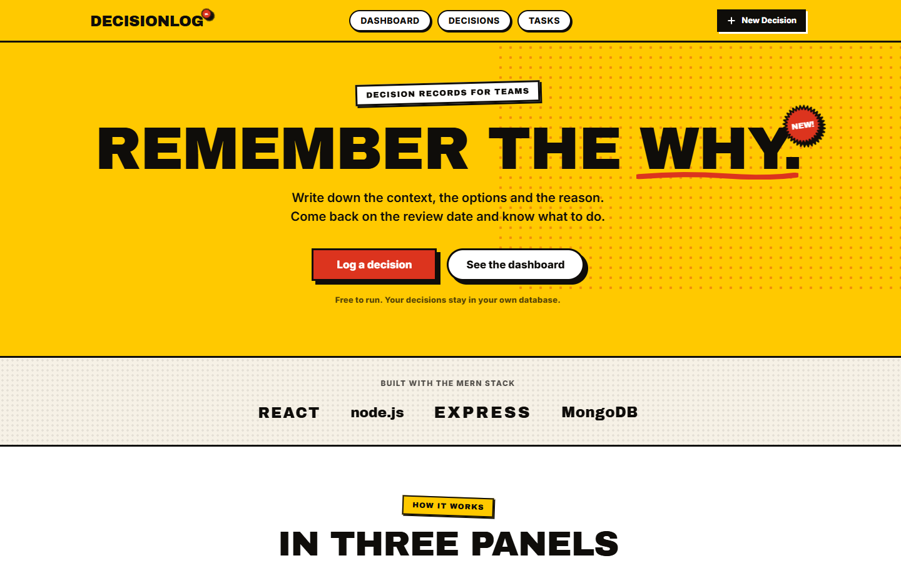 | 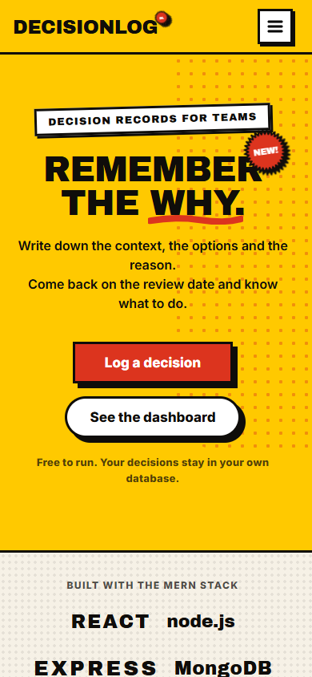 |

| Dashboard (1440px) | Decisions List (1440px) |
| :---: | :---: |
| 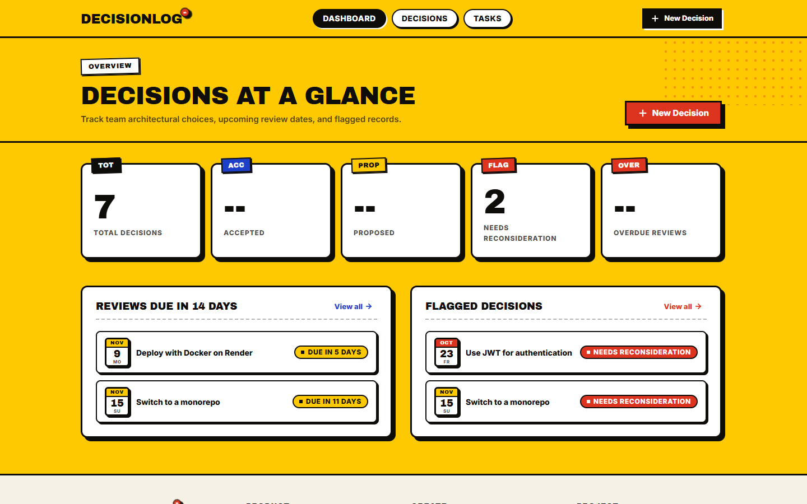 | 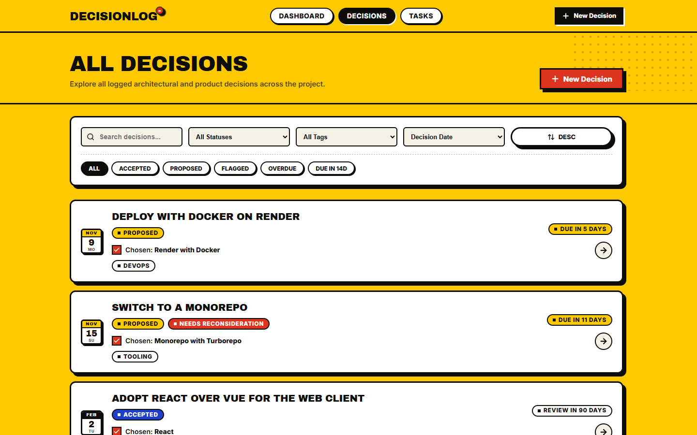 |

| Mobile Filters Bottom Sheet (390px) | Decision Detail (1440px) |
| :---: | :---: |
| 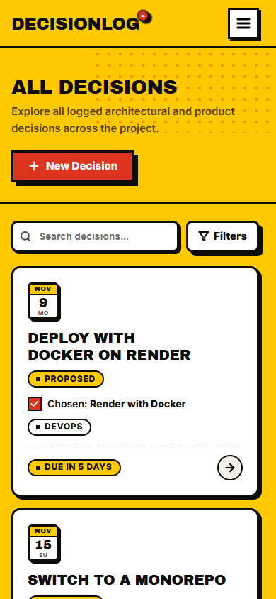 | 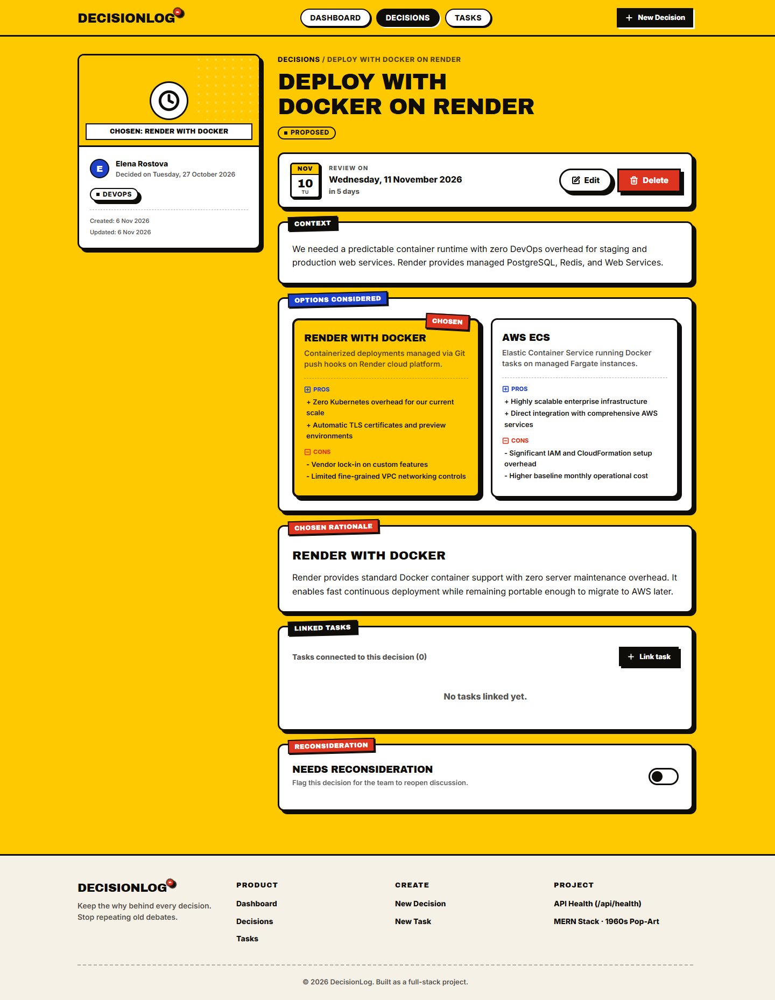 |

| Decision Form (1440px) | Tasks Management (1440px) |
| :---: | :---: |
| 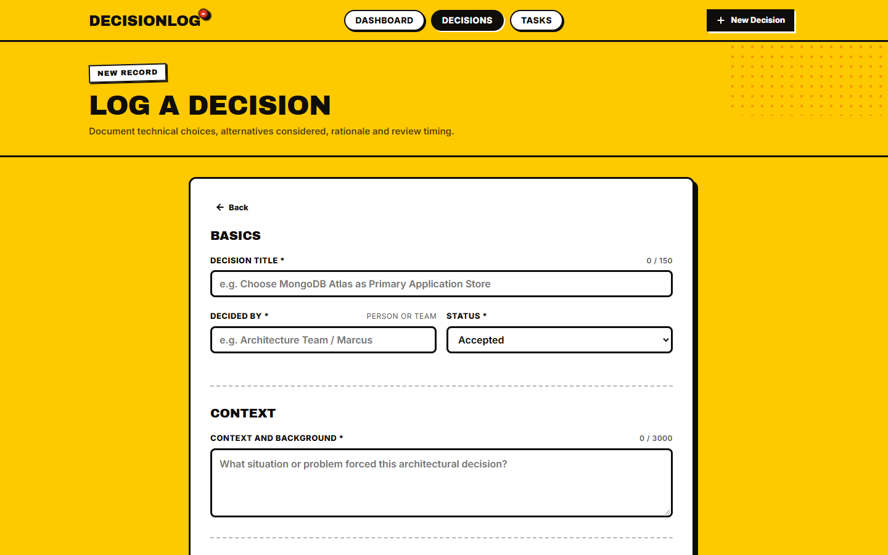 | 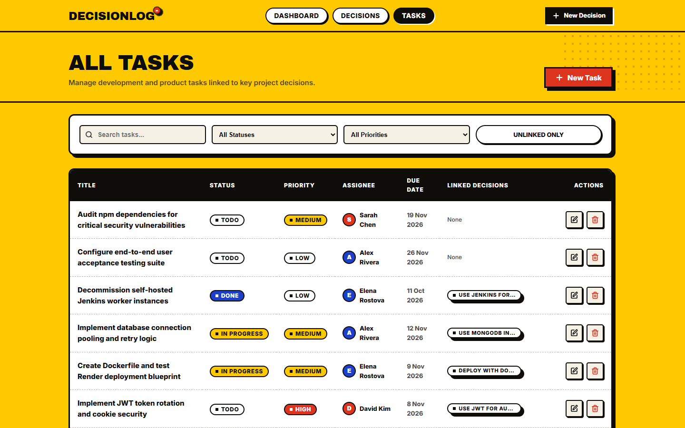 |

| Footer Online (Green Status Light) | Footer Degraded (Database Down 503) |
| :---: | :---: |
| 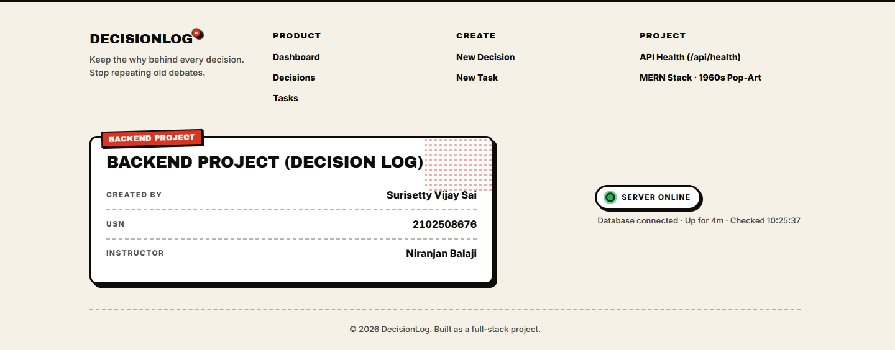 | 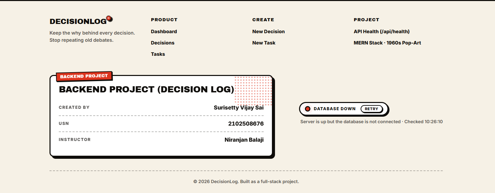 |

| Footer Offline (Server Down) | |
| :---: | :---: |
| 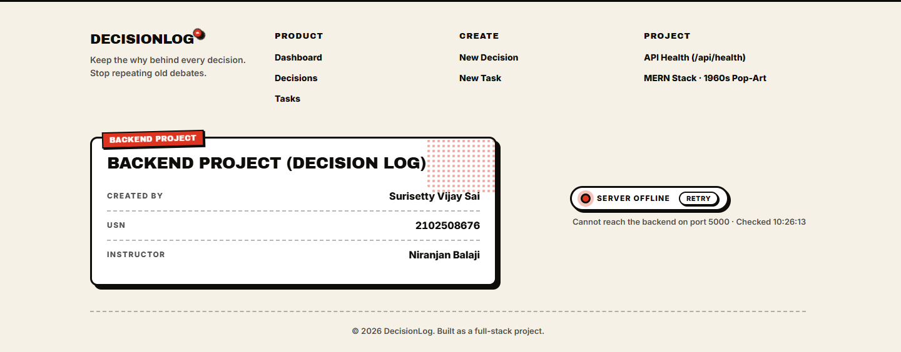 | |

---

## 12. Troubleshooting

### 1. MongoDB Connection Refused (`ECONNREFUSED 127.0.0.1:27017`)
- **Cause**: Local MongoDB service is not started.
- **Fix**: Run `docker compose up -d` or use the included in-memory runner `node server/scripts/mongo-runner.js`.

### 2. Port Already in Use (`EADDRINUSE: 5000` or `5173`)
- **Cause**: A previously running node or vite process is holding the port.
- **Fix**:
  - Windows PowerShell:
    ```powershell
    Get-NetTCPConnection -LocalPort 5000, 5173 | ForEach-Object { Stop-Process -Id $_.OwningProcess -Force }
    ```
  - Linux / macOS:
    ```bash
    kill -9 $(lsof -ti:5000,5173)
    ```

### 3. Proxy Errors (`[vite] http proxy error`)
- **Cause**: The Vite frontend dev server is running on port 5173, but the Express backend on port 5000 is stopped.
- **Fix**: Start the backend server (`npm --prefix server run dev`) or use the root `npm run dev` script to run both simultaneously.

### 4. CORS Errors in Browser Console
- **Cause**: `CLIENT_ORIGIN` in `server/.env` does not match the frontend URL.
- **Fix**: Verify `server/.env` has `CLIENT_ORIGIN=http://localhost:5173`.

### 5. Google Fonts Fallback Display
- **Cause**: Offline environment or firewall blocking Google Fonts.
- **Fix**: The application includes explicit, styled fallback font stacks (`Archivo Black, Impact, "Arial Black"` for display, and `Inter, -apple-system, BlinkMacSystemFont, "Segoe UI"` for body) to ensure full legibility with zero layout disruption.

